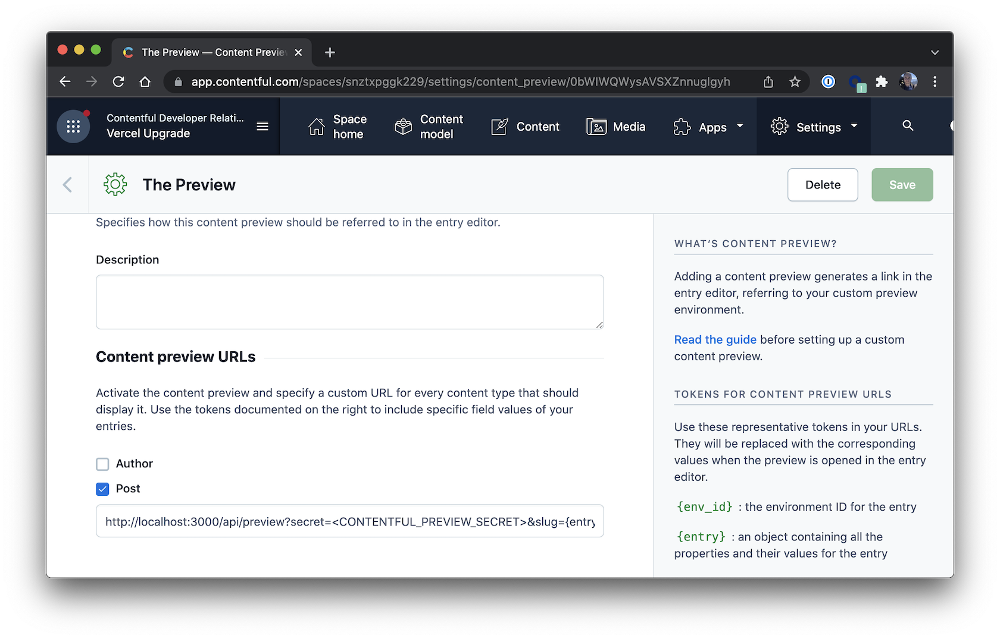
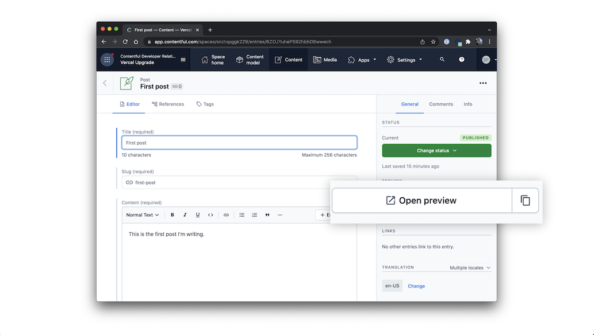
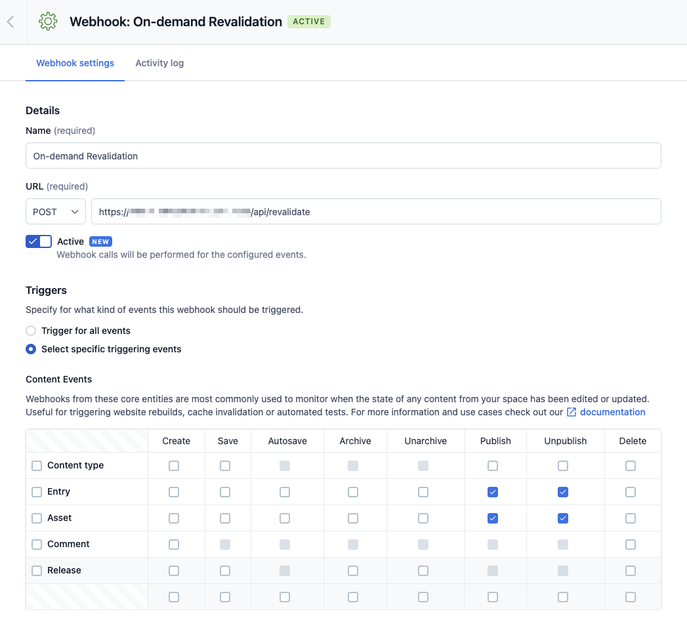
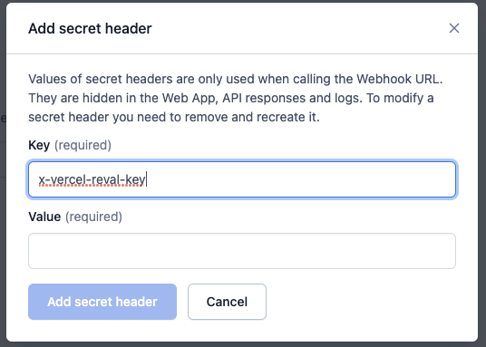
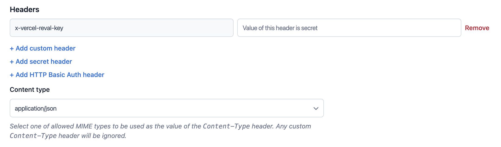
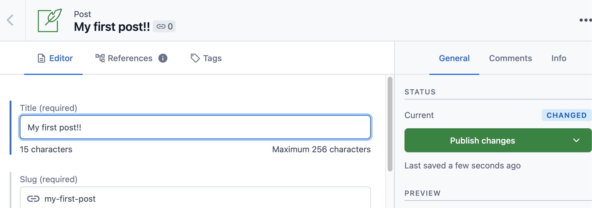
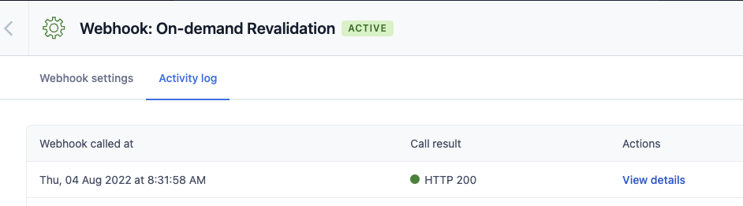

# Statically Generated Design Portfolio

Designed by and featuring Steven Vasil.
## Tech
- Next.js
- Contentful
- Emotion

## Features

### Current Project Teaser

A lightweight, code-defined "currently building" callout that appears on the home page between the intro section and the project list. It's intended for in-progress projects that don't yet warrant a full case study but you still want to surface for visitors (e.g. a recruiter visiting from a job application).

The teaser links to a standalone page at `/current` that renders a minimal stub — a status pill at the top, the project title and intro, and a CTA out to the live demo. The page is intentionally short (designed to fit on one desktop screen) so it can be shipped without writing a full case study. The `/current` page does NOT fetch from Contentful; all content lives in code so you can ship updates quickly without round-tripping through the CMS.

**To update the home page teaser copy:**
Edit the `CURRENT_PROJECT_TEASER` constants block at the top of `components/CurrentProjectTeaser/current-project-teaser.tsx`:

- `eyebrow` — small label above the title (default: `"Currently building"`)
- `title` — project name
- `status` — one-line description shown on the home page
- `href` — internal route to the detail page (default: `"/current"`)

**To update the `/current` page content:**
Edit the `CURRENT_PROJECT_PAGE` constants block at the top of `components/CurrentProjectPage/current-project-page.tsx`:

- `title`, `introduction` — passed to `IntroSection`
- `status` — short pill label rendered at the top of the page (e.g. `"In active development"`)
- `demoUrl` — external URL to the live demo (opens in a new tab)
- `demoNote` — short note about the demo's intended environment (defaults to an iPad-mini / desktop note)

The page renders a single centered `HeroSection` containing, in order: title, status label (text with an orange dot, no background), intro paragraph, and the demo CTA + iPad-mini note. `PageWrapper` has `min-height: 100vh` so the white area fills the viewport and the footer drops below the fold.

**To remove the teaser entirely** once a full case study replaces it: delete the `<CurrentProjectTeaser />` line in `pages/index.tsx` and (optionally) remove the `components/CurrentProjectTeaser/` and `components/CurrentProjectPage/` directories and `pages/current.tsx`.

### TODO
#### Setup Preview Mode:

In your Contentful space, go to **Settings > Content preview** and add a new content preview for development.

The **Name** field may be anything, like `Development`. Then, under **Content preview URLs**, check **Post** and set its value to:

```
http://localhost:3000/api/preview?secret=<CONTENTFUL_PREVIEW_SECRET>&slug={entry.fields.slug}
```

Replace `<CONTENTFUL_PREVIEW_SECRET>` with its respective value in `.env.local`.



Once saved, go to one of the posts you've created and:

- **Update the title**. For example, you can add `[Draft]` in front of the title.
- The state of the post will switch to **CHANGED** automatically. **Do not** publish it. By doing this, the post will be in draft state.
- In the sidebar, you will see the **Open preview** button. Click on it!



You will now be able to see the updated title. To exit preview mode, you can click on **Click here to exit preview mode** at the top of the page.

#### Enable On-Demand Revalidation

In your Contentful space, go to **Settings > Webhooks** and add a new webhook:

- **Give the webhook a name**
- **Activate:** Check the activate checkbox to ensure the webhook is marked as active
- **Specify the POST URL:** Using the URL from your Vercel deployment in step 8, add the path `/api/revalidate` at the end, so it would look something like:

  ```
  https://<YOUR_VERCEL_DEPLOYMENT_URL>/api/revalidate
  ```

  Replace `<YOUR_VERCEL_DEPLOYMENT_URL>` with your own deployment URL as noted in the Vercel dashboard.

- **Specify Triggers:** You can choose to trigger for all events or specific events only, such as the Publishing and Unpublishing of Entries and Assets, as shown below.

  

- **Specify Secret Header:** Add a secret header named `x-vercel-reval-key` and enter the value of the
  `CONTENTFUL_REVALIDATE_SECRET` from before.

  

- **Set Content type:** Set content type to `application/json` in the dropdown.

  

- **Edit post:** Now, try editing the title of one of your blog posts in Contentful and click Publish. You should see the changed reflected in the website you just deployed, all without triggering a build! Behind the scenes a call was made to the revalidate api that triggers a revalidation of both the landing page and the specific post that was changed.

  

- **Verify:** You can verify if your request was made successfully by checking the webhook request log on Contentful and checking for a successful 200 status code, or by having your functions tab open on Vercel when committing the change (log drains may also be used). If you are experiencing issues with the api call, ensure you have correctly entered in the value for environment variable `CONTENTFUL_REVALIDATE_SECRET` within your Vercel deployment.

  
